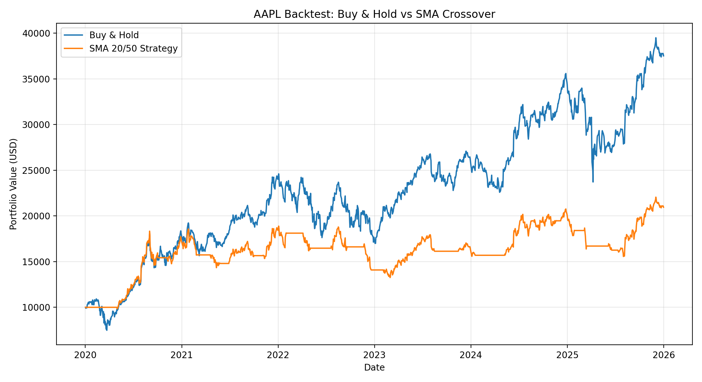

# Stock Trading Strategy Backtester

A Python-based quantitative finance project that implements and evaluates moving average crossover trading strategies using historical Apple (AAPL) stock data from 2020 to 2025.

The project compares systematic trading strategies against a Buy & Hold benchmark, focusing on portfolio returns, risk-adjusted performance, and the impact of different moving average parameters.

## Project Overview

This project explores whether moving average crossover strategies can improve investment performance or reduce risk compared with passive investing.

**Key features:**
- Historical market data retrieval using `yfinance`
- Simple Moving Average (SMA) crossover signals
- Backtesting with an initial portfolio value of $10,000
- One-day signal lag to avoid look-ahead bias
- Transaction cost modeling (0.1% per position change)
- Portfolio performance and risk metrics
- Comparison of SMA 10/30, 20/50, and 50/200 strategies

## Methodology

### Data

- **Asset:** Apple Inc. (AAPL)
- **Period:** January 2020 – December 2025
- **Frequency:** Daily
- **Price series:** Adjusted closing prices

### Trading Strategy

Two moving averages are calculated:

- Short-term SMA: average closing price over the shorter window
- Long-term SMA: average closing price over the longer window

**Trading rules:**
- If Short SMA > Long SMA: hold the stock
- Otherwise: hold cash

Trading signals are shifted by one trading day to prevent using information unavailable at the time of the modeled position.

### Backtesting Assumptions

- Initial capital: $10,000
- Long-only, fully invested or fully in cash
- Transaction cost: 0.1% per position change
- No leverage or short selling
- Zero cash interest and zero risk-free rate
- Daily portfolio compounding

## Backtest Results

| Metric | Buy & Hold | SMA 20/50 |
|---|---:|---:|
| Cumulative Return | 275.14% | 109.49% |
| Annualized Return | 24.72% | 13.15% |
| Annualized Volatility | 31.80% | 20.33% |
| Sharpe Ratio | 0.8535 | 0.7093 |
| Maximum Drawdown | -33.36% | -29.80% |

### Portfolio Performance



## Parameter Comparison

| Strategy | Cumulative Return | Sharpe Ratio | Max Drawdown | Position Changes |
|---|---:|---:|---:|---:|
| SMA 10/30 | 74.46% | 0.5525 | -31.07% | 52 |
| SMA 20/50 | 109.49% | 0.7093 | -29.80% | 33 |
| SMA 50/200 | 20.68% | 0.2564 | -30.79% | 9 |

## Key Findings

1. **Buy & Hold outperformed the SMA strategies in absolute returns.** Over the selected period, remaining invested in AAPL captured more of the stock's long-term appreciation.

2. **The SMA 20/50 strategy reduced volatility and maximum drawdown.** However, the reduction in risk came at the cost of lower returns and a lower Sharpe Ratio.

3. **More frequent trading did not guarantee better performance.** SMA 10/30 generated 52 position changes but underperformed SMA 20/50, which generated 33.

4. **Parameter selection materially affected outcomes.** SMA 20/50 performed best among the tested combinations, although this does not establish its effectiveness outside the historical sample.

## Project Structure

```text
stock-strategy-backtester/
├── data.py
├── strategy.py
├── backtest.py
├── metrics.py
├── compare.py
├── aapl_data.csv
├── aapl_price_history.png
├── moving_averages.png
├── backtest_comparison.png
├── performance_metrics.csv
├── strategy_comparison.csv
├── requirements.txt
├── .gitignore
└── README.md
```

## How to Run

Install dependencies:

```bash
python3 -m pip install -r requirements.txt
```

Download and prepare market data:

```bash
python3 data.py
```

Visualize the moving average strategy:

```bash
python3 strategy.py
```

Run the backtest:

```bash
python3 backtest.py
```

Compare different SMA parameters:

```bash
python3 compare.py
```

## Limitations and Future Improvements

- Results are based on a single stock and historical sample.
- The parameter comparison is in-sample and may be subject to overfitting.
- Transaction costs are simplified and do not model detailed order execution, bid-ask spreads, or slippage.
- The one-day signal lag is an approximation rather than a full next-day execution simulator.
- Cash interest, taxes, and financing effects are excluded.
- Future work could incorporate out-of-sample testing, multiple stocks, momentum strategies, and more realistic execution assumptions.

## Technologies

Python · Pandas · NumPy · Matplotlib · yfinance

---

*For educational and research purposes only. Historical performance does not guarantee future investment results.*